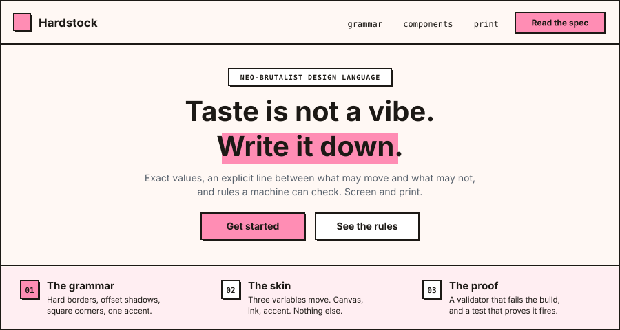
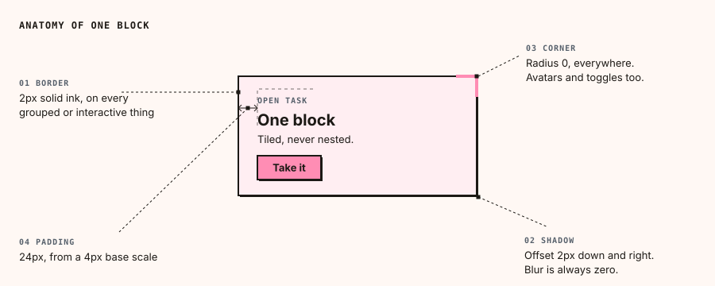
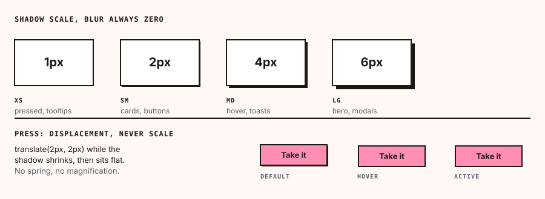
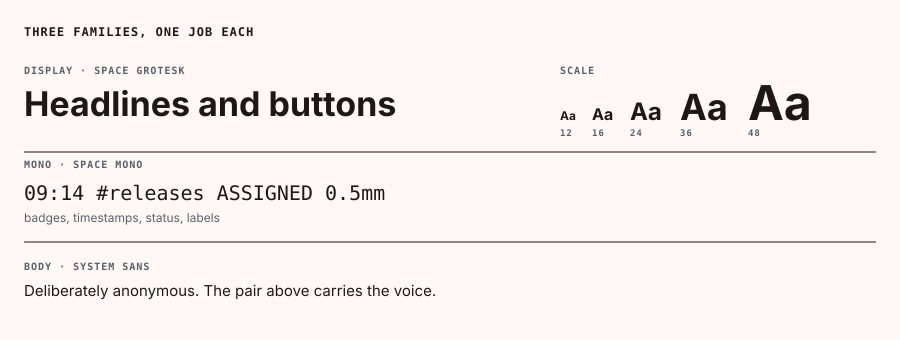
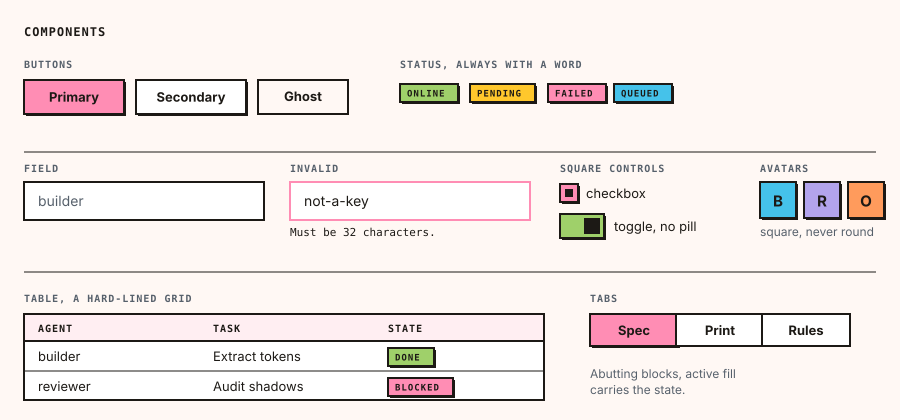
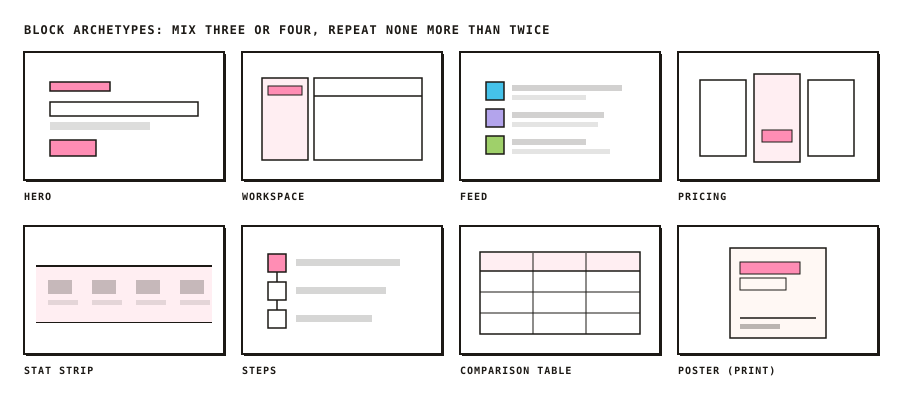
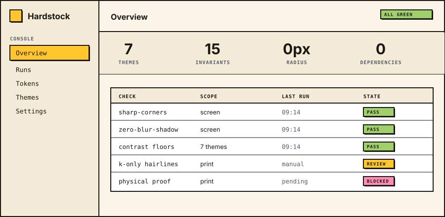
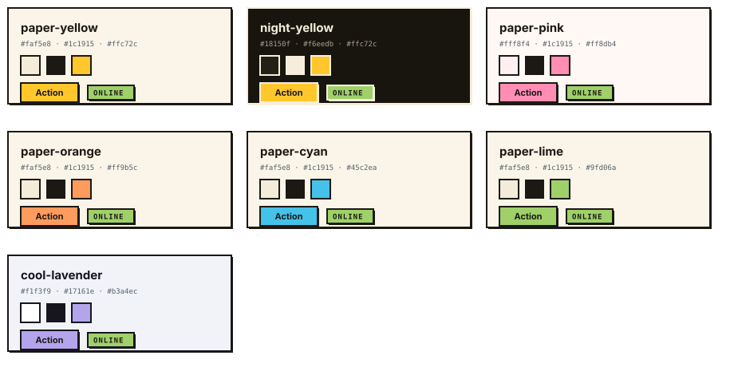
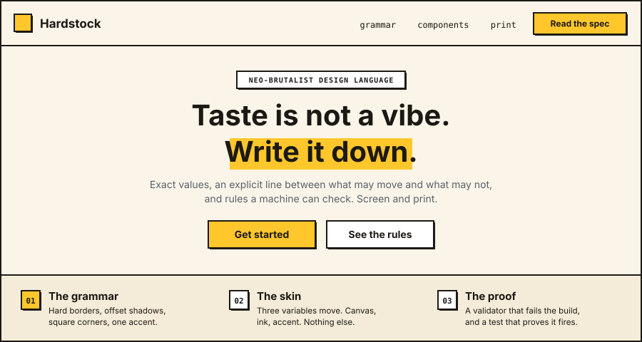
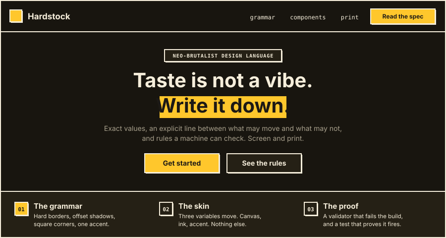

# Hardstock

[](README.md)
[](README.zh-CN.md)
[](LICENSE)
[](SKILL.md)

A neo-brutalist design language for screen and print, packaged so an AI agent can apply it
the same way twice. It is a design language in the neo-brutalist tradition: the idiom is
public, and what this repository adds is the specification.

Warm paper canvas. One ink that draws every rule, every shadow and every word. Square
corners with no exceptions. Depth from displacement instead of blur. One saturated accent.



Most design systems ship colors and components and hope the taste comes along for the ride.
Hardstock ships the taste as data: tokens, themes, component contracts and page-level block
archetypes in JSON, a set of invariants an agent must satisfy, and a validator that fails
the build on the nine of them a machine can check.

## Quick start

```bash
git clone https://github.com/weijt606/hardstock-design.git
cd hardstock-design
python3 -m http.server 8000   # then open /examples/components.html
npm test                      # proves the validator actually fires
```

The stylesheet needs nothing. The tools in `tools/` need Node 18 or later and have no
dependencies, so there is no `npm install` step.

## Use it in a page

```html
<link rel="stylesheet" href="https://fonts.googleapis.com/css2?family=Space+Grotesk:wght@400;500;600;700&family=Space+Mono:wght@400;700&display=swap">
<link rel="stylesheet" href="dist/hardstock.css">

<body data-hs-theme="paper-yellow">
  <button class="hs-btn hs-btn--primary">Ship it</button>
  <span class="hs-badge hs-badge--success">online</span>
</body>
```

No build step, no package manager, no runtime dependency. On Tailwind v4, import
`dist/hardstock.theme.css` instead and write utilities against the same tokens.

## The grammar

Four decisions carry the whole language. Everything else is downstream of them.



Depth comes from displacement rather than softness, which is why the shadow scale is four
offsets and no blur, and why pressing a button moves it toward the page instead of lighting
it up.



Three families, one job each. The uppercase mono micro-label is the signature move: it
appears in every badge, eyebrow, timestamp and table header, and it is most of what stops
the page reading as a generic sans-serif template.



## Components

Every component inherits the same chrome: 2px ink border, square corners, offset shadow, ink
text on whatever fill it carries. Contracts live in `design/components.json`, implementations
in `dist/hardstock.css`.



Note the square checkbox, the rectangular toggle and the square avatars. Those three are
where this language most often gets diluted back into a generic one.

## Composition

Components make elements; blocks make pages. `design/blocks.json` carries the vocabulary and
ready-made recipes per page type. The discipline is to mix three or four archetypes and
repeat none more than twice, because a page that is nothing but a feature grid is the
loudest possible tell that nobody made a layout decision.



The same grammar runs an app shell. A console is a hard-lined table, a stat strip and a
sidebar, which this language happens to be unusually good at.



## Use it with an agent

This repository is also a [Claude Code skill](https://code.claude.com/docs/en/skills).
`SKILL.md` at the root is the agent entry point.

```bash
ln -s "$PWD" ~/.claude/skills/hardstock-design
```

Ask for a page in the Hardstock style. The agent reads the tokens, picks a theme and a block
sequence, builds the page, then runs the validator on its own output. For other harnesses,
hand over `SKILL.md` and the `design/` directory, and point at
`references/generation-protocol.md`.

If you are pasting into something else:

```
Build <page> using the Hardstock design language.
Tokens design/tokens.json, theme <id> from design/themes.json,
blocks from design/blocks.json, components design/components.json.
Every error-level rule in design/rules.json is mandatory.
Order: tokens, then bordered region layout, then components, then motion.
Finish by running node tools/validate.mjs and fixing everything it reports.
```

## What is in the box

| Path | Contents |
| --- | --- |
| `design/tokens.json` | Every color, type, space, border, shadow and motion value |
| `design/themes.json` | Seven tested themes and the recipe for deriving new ones |
| `design/components.json` | Component contracts: anatomy, chrome, all five states |
| `design/blocks.json` | Block archetypes and recipes, for screen and for print |
| `design/rules.json` | The invariants, marked by medium and by machine-checkability |
| `dist/hardstock.css` | Drop-in stylesheet, all components, all seven themes |
| `dist/hardstock.theme.css` | The same tokens as a Tailwind v4 `@theme` block |
| `references/print.md` | The print layer: units, ink, trim, archetypes, handoff |
| `references/` | Full spec, build protocol, porting and extension guide |
| `examples/` | Working app shell, landing page, component gallery |
| `screens/` | Every figure above, generated from the tokens by `tools/render-figures.mjs` |
| `tools/` | Static validator, contrast checker, figure renderer, browser audit, self-test |

## The rules

These are what decide whether a result is this language or something else. `design/rules.json`
holds all sixteen in machine-readable form and marks which are machine-checkable. The
validator checks nine of them. The other seven need eyes, and they include some of the most
important: no nested cards, the accent never carrying meaning, status never carried by color
alone.

- `border-radius` is 0 everywhere, including avatars, toggles, radios and modals.
- Every `box-shadow` has a blur of 0. Depth is displacement.
- Text on any colored fill is ink, in light and dark themes both. Never grey, never white,
  and never the reverse: a neutral surface takes ink, not the on-fill color.
- Exactly one accent per page. The accent is brand, never meaning.
- No card inside a card. Regions are separated by hard borders, not by layering.
- No bounce, spring, overshoot easing, scale-up or blur transition.
- No emoji. Monoline SVG at 1.5 to 2px stroke, or an uppercase mono label.
- Colored status always carries a word as well, because color alone is not readable to
  everyone.
- A reduced-motion opt-out and a visible ink focus ring, always.

## Themes

A theme moves three variables: canvas, ink, accent. The grammar underneath does not move.
That is what lets one language produce products that do not look like siblings.



| Theme id | Canvas | Accent | Fits |
| --- | --- | --- | --- |
| `paper-yellow` (default) | warm cream | yellow | Agent workspaces, developer tools |
| `night-yellow` | warm black | yellow | Dashboards, monitoring, night use |
| `paper-pink` | blush paper | pink | Creative tools, community products |
| `paper-orange` | warm cream | orange | Food, community, lifestyle |
| `paper-cyan` | warm cream | cyan | Technical tools and infrastructure |
| `paper-lime` | warm cream | lime | Health, sustainability, finance |
| `cool-lavender` | cool paper | lavender | B2B and professional products |

```html
<body data-hs-theme="night-yellow">
```

The same screen, unchanged, in two other themes. Nothing moved except canvas, ink and accent.





Dark is warm black with warm white ink, never `#000` and never cool grey, and text on a
colored fill stays dark even there.

`references/adapting.md` has the derivation recipe for an eighth. An accent has to clear
4.5:1 against ink before it ships, and that is measured rather than assumed:

```bash
node tools/contrast.mjs '#fff8f4' '#1c1915' '#ff8db4'          # check a candidate
node tools/contrast.mjs --dark '#18150f' '#f6eedb' '#ffc72c'   # a dark candidate
node tools/contrast.mjs                                        # re-check every theme
```

Pass `--dark` for a dark candidate. Without it the accent is measured against the light
ink, and a perfectly good dark theme fails.

## Print

This language did not start on screens. Hard rules, flat color blocks, offset shapes
standing in for depth, uppercase mono metadata: that is letterpress, riso and index cards,
borrowed into CSS. It goes back to paper without translation.

The implementation does not. `references/print.md` is a full second layer, because pixel
values, CMYK gamut, ink registration and trim tolerance have no screen equivalent.

Measurements are re-derived from ratios rather than converted. The web spec is a 2px rule
against 16px body, so the rule is body divided by 8, the small shadow offset equals the rule
weight, spacing base is body divided by 4, block padding is 1.5 times body. Set a body size
for the piece and the rest follows, with a floor per printing process so a hairline never
falls below what the press can hold.

Two things get better on paper. The canvas token stops being an ink and becomes a paper
choice, which is cheaper and more honest for a language named after card stock. And the
one-accent rule turns into a two-color job, black plus one spot, which costs less than
four-color and reaches saturations CMYK cannot. The discipline that keeps the screen
version clean is what keeps the printed version cheap.

The print layer covers unit derivation and process minimums, paper and ink including the
rich-black and K-only-hairline rules that decide whether a piece survives the press, spot
color starting points, trim clearance, images, seven composition archetypes, print-specific
anti-patterns, and a handoff checklist. `design/rules.json` carries the print invariants
alongside the screen ones and marks which screen rules do not apply.

The validator is screen-only. Nothing checks a print file automatically, so the checklist
at the end of `references/print.md` is the substitute, and a physical proof is the real one.

## Validation

```bash
node tools/validate.mjs examples/landing.html
node tools/validate.mjs --json src/          # machine-readable, for CI
node tools/selftest.mjs                      # asserts the checker still fires
```

The validator reads HTML and CSS statically and reports non-zero radii, blurred shadows,
overshoot easing, scale transforms, backdrop blur, emoji, missing reduced-motion blocks,
removed focus outlines, multiple accents and off-palette hex values. It exits non-zero on
any error, so it drops into CI as one line.

For a rendered page, paste `tools/audit.js` into the browser console. It walks computed
styles, which catches radii and blurs that arrive from a framework rather than your source.

Neither one can see the rules that need eyes. `references/generation-protocol.md` has the
manual checklist that goes with them.

## When not to use it

This language is loud on purpose. It suits tools, developer products, agent interfaces,
marketing pages that want to look built, and print work that wants ink on paper to look like
ink on paper. It is a poor fit for dense financial terminals, clinical software, or anything
whose job is to disappear behind its content. Reach for something quieter there.

In print it is also a poor fit for anything needing photographic color fidelity. The system
assumes flat ink and few plates, and a full-color image inside a two-ink piece breaks both
the look and the budget.

## Credits

Hardstock is neo-brutalist design, which takes its name and its ethics from architectural
brutalism: exposed structure, no ornament, function stated plainly. The idiom is public and
long predates this repository.

What is particular here is not the style but the decision to write it down all the way:
exact values instead of ranges, an explicit line between what may move and what may not,
rules handed to a machine that can check them, and enough specification that the same brief
produces the same result twice.

Typefaces are [Space Grotesk](https://fonts.google.com/specimen/Space+Grotesk) by Florian
Karsten and [Space Mono](https://fonts.google.com/specimen/Space+Mono) by Colophon Foundry,
both under the SIL Open Font License. They are loaded from Google Fonts and are not
redistributed here.

## Contributing

Issues and pull requests are welcome. Two conditions: `node tools/selftest.mjs` passes, and
any change to a value in `design/` is reflected in `dist/` and in the docs that quote it.

New components go into `design/components.json` before they go into CSS, because the contract
is what other agents read.

## License

MIT. See [LICENSE](LICENSE).
