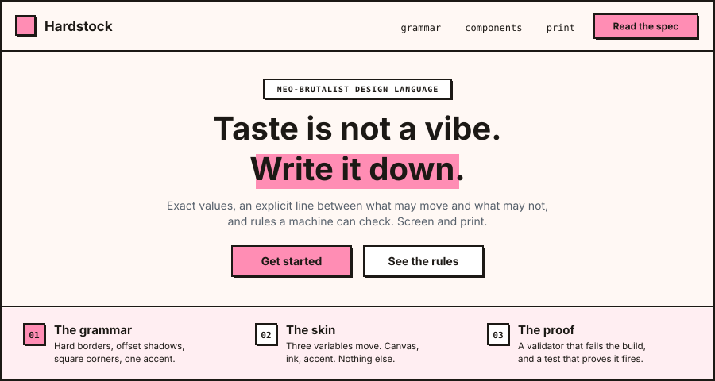
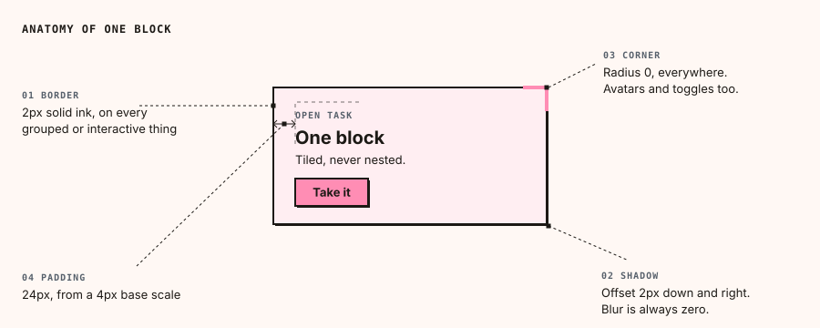
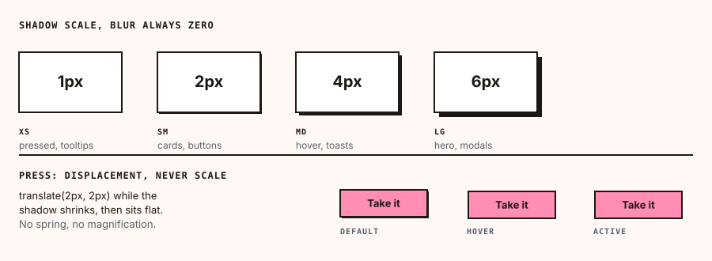
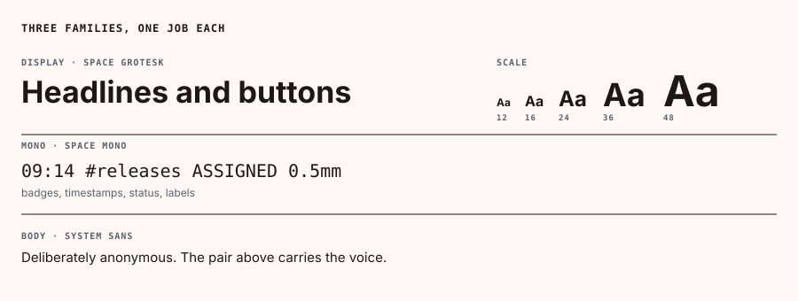
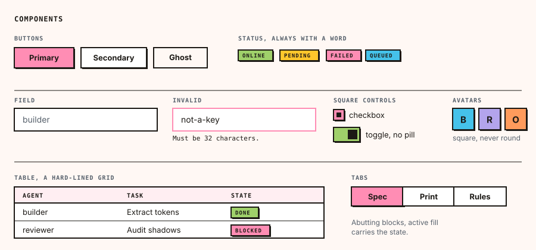
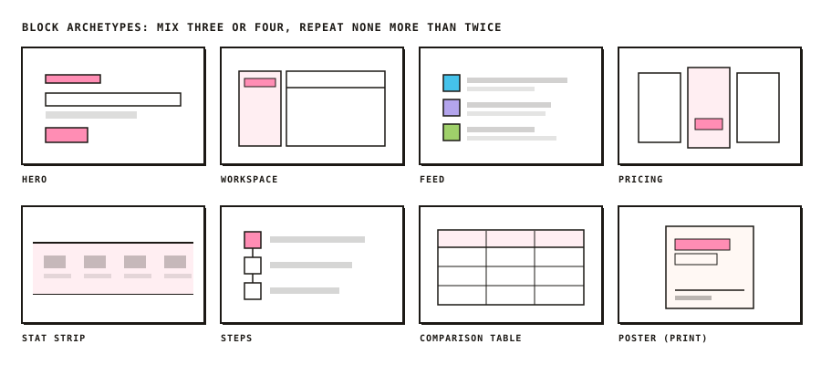
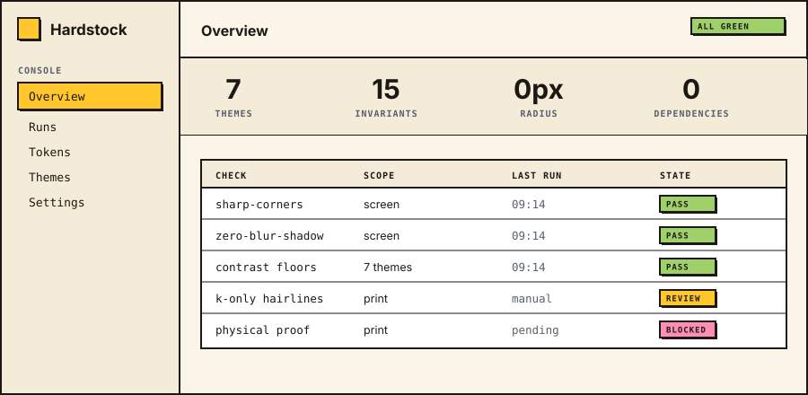
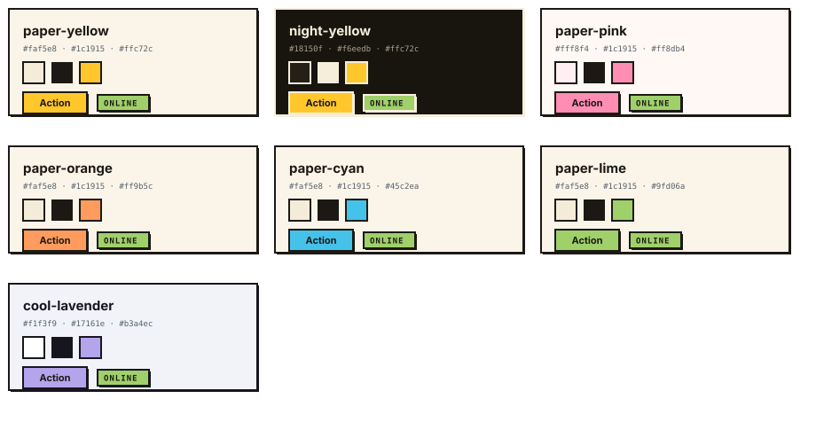
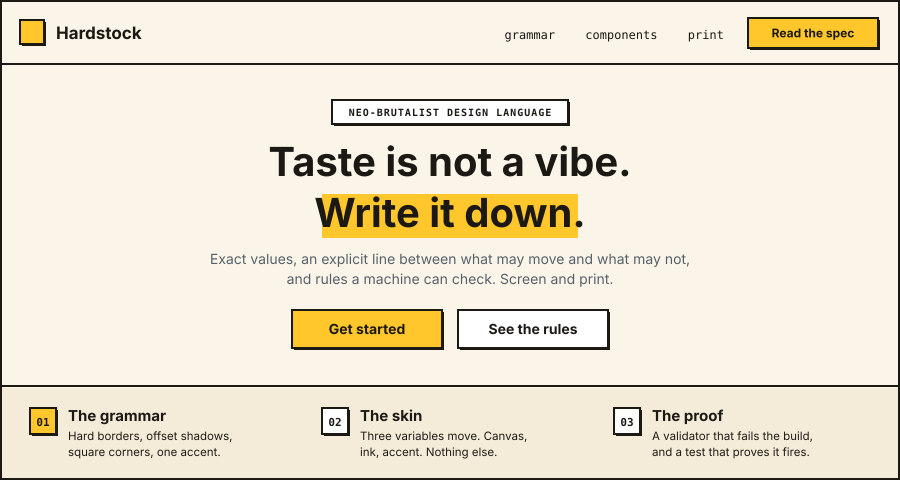
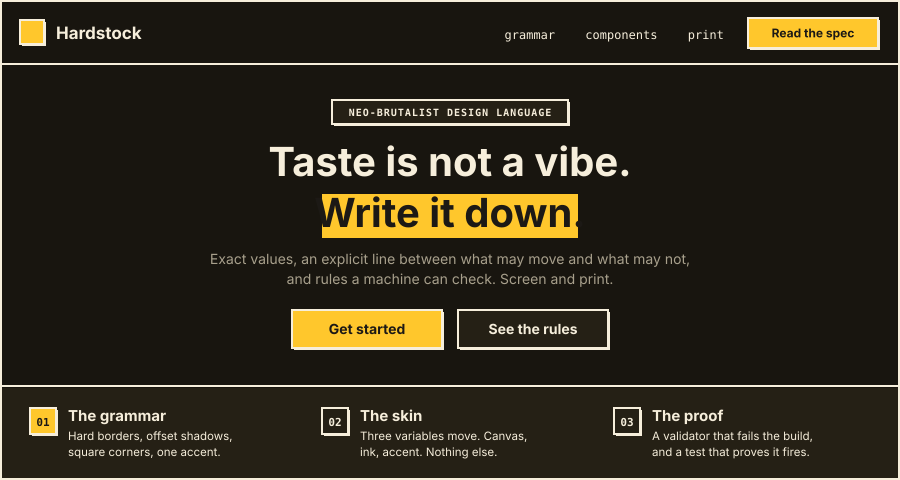

# Hardstock Design

[](README.md)
[](README.zh-CN.md)
[](LICENSE)
[](SKILL.md)

一套面向屏幕与印刷的新粗野主义（neo-brutalist）设计语言，打包成 AI agent 可以稳定复现的形式：同一份需求，两次生成的结果一致。它属于新粗野主义这一公共设计流派，风格本身人人可用，这个仓库补上的是一份完整的规范。

暖色纸面底。一种墨色画出所有线条、所有投影、所有文字。所有角都是直角，没有例外。立体感来自位移而不是模糊。只有一个高饱和点缀色。



大多数设计系统只交付颜色和组件，然后指望审美自己跟上。Hardstock 把审美本身写成了数据：JSON 格式的 token、主题、组件契约和页面级区块原型，一组 agent 必须满足的不变量，以及一个校验器。不变量里有九条可以由机器检查，违反任何一条，校验器都会让构建失败。

## 快速开始

```bash
git clone https://github.com/weijt606/hardstock-design.git
cd hardstock-design
python3 -m http.server 8000   # 然后打开 /examples/components.html
npm test                      # 证明校验器确实会报错
```

样式表本身没有任何依赖。`tools/` 里的工具需要 Node 18 及以上版本，同样零依赖，所以不需要 `npm install`。

## 在页面中使用

```html
<link rel="stylesheet" href="https://fonts.googleapis.com/css2?family=Space+Grotesk:wght@400;500;600;700&family=Space+Mono:wght@400;700&display=swap">
<link rel="stylesheet" href="dist/hardstock.css">

<body data-hs-theme="paper-yellow">
  <button class="hs-btn hs-btn--primary">Ship it</button>
  <span class="hs-badge hs-badge--success">online</span>
</body>
```

没有构建步骤，没有包管理器，没有运行时依赖。使用 Tailwind v4 时，改为引入 `dist/hardstock.theme.css`，用同一套 token 写 utility class。

## 语法

整套语言由四个决定撑起，其他一切都从这四点推导出来。



立体感来自位移而不是柔化，所以投影阶梯是四档偏移、没有模糊；按下按钮时，它是朝页面移动，而不是变亮。



三种字体，各司其职。大写等宽微标签是这套语言的招牌：它出现在每个徽章、眉标、时间戳和表头里，页面之所以不像一个普通无衬线模板，主要靠它。



## 组件

每个组件都继承同一套外壳：2px 墨色边框、直角、偏移投影，无论什么底色上都用墨色文字。组件契约在 `design/components.json`，实现在 `dist/hardstock.css`。



注意方形复选框、矩形开关和方形头像。这三处是这套语言最容易被稀释回普通风格的地方。

## 版式组合

组件组成元素，区块组成页面。`design/blocks.json` 收录了区块词汇和按页面类型准备好的配方。纪律是：一个页面混用三到四种原型，同一种最多重复两次。整页只有特性网格，是"没人做过版式决策"最明显的信号。



同一套语法也能撑起应用界面。一个控制台就是一张硬线表格、一条统计条和一个侧栏，而这正是这套语言特别擅长的。



## 配合 agent 使用

这个仓库同时也是一个 [Claude Code skill](https://code.claude.com/docs/en/skills)，根目录的 `SKILL.md` 是 agent 的入口。

```bash
ln -s "$PWD" ~/.claude/skills/hardstock-design
```

让 agent 用 Hardstock 风格做一个页面即可。agent 会读取 token，选定主题和区块顺序，搭建页面，然后对自己的产出运行校验器。其他 agent 框架的话，把 `SKILL.md` 和 `design/` 目录交给它，并指向 `references/generation-protocol.md`。

如果要粘贴到别的工具里：

```
Build <page> using the Hardstock design language.
Tokens design/tokens.json, theme <id> from design/themes.json,
blocks from design/blocks.json, components design/components.json.
Every error-level rule in design/rules.json is mandatory.
Order: tokens, then bordered region layout, then components, then motion.
Finish by running node tools/validate.mjs and fixing everything it reports.
```

## 内容一览

| 路径 | 内容 |
| --- | --- |
| `design/tokens.json` | 所有颜色、字体、间距、边框、投影和动效的取值 |
| `design/themes.json` | 七个经过测试的主题，以及派生新主题的方法 |
| `design/components.json` | 组件契约：结构、外壳、全部五种状态 |
| `design/blocks.json` | 区块原型与配方，覆盖屏幕和印刷 |
| `design/rules.json` | 不变量，按媒介和是否可机器检查标注 |
| `dist/hardstock.css` | 即插即用的样式表，包含全部组件和七个主题 |
| `dist/hardstock.theme.css` | 同一套 token 的 Tailwind v4 `@theme` 版本 |
| `references/print.md` | 印刷层：单位、油墨、裁切、原型、交付 |
| `references/` | 完整规范、构建流程、移植和扩展指南（英文） |
| `examples/` | 可运行的应用外壳、落地页、组件展示页 |
| `screens/` | 本文所有配图，由 `tools/render-figures.mjs` 从 token 生成 |
| `tools/` | 静态校验器、对比度检查、配图渲染、浏览器审计、自测 |

## 规则

这些规则决定一个结果算不算这套语言。`design/rules.json` 以机器可读的形式收录了全部十六条，并标注了哪些可由机器检查。校验器检查其中九条，另外七条需要人眼判断，其中包括几条最重要的：不嵌套卡片、点缀色不承载语义、状态不能只靠颜色表达。

- `border-radius` 处处为 0，包括头像、开关、单选框和弹层。
- 每个 `box-shadow` 的模糊半径都是 0。立体感就是位移。
- 任何彩色底上的文字都用墨色，亮色和暗色主题都一样。不用灰色，不用白色，也不能反过来：中性底面用墨色，而不是彩底文字色。
- 每页只有一个点缀色。点缀色是品牌，从不表示语义。
- 卡片里不套卡片。区域之间靠硬边框分隔，而不是靠层叠。
- 不用回弹、弹簧、过冲缓动、放大或模糊过渡。
- 不用 emoji。用 1.5 到 2px 描边的单线 SVG，或大写等宽标签。
- 带颜色的状态必须同时带文字，因为不是每个人都能分辨颜色。
- 始终提供减弱动效的选项，以及可见的墨色焦点环。

## 主题

一个主题只改三个变量：底色、墨色、点缀色，底下的语法不动。正因如此，同一套语言能做出彼此不像兄弟的产品。



| 主题 id | 底色 | 点缀色 | 适合 |
| --- | --- | --- | --- |
| `paper-yellow`（默认） | 暖奶油 | 黄 | agent 工作台、开发者工具 |
| `night-yellow` | 暖黑 | 黄 | 仪表盘、监控、夜间使用 |
| `paper-pink` | 淡粉纸 | 粉 | 创作工具、社区产品 |
| `paper-orange` | 暖奶油 | 橙 | 餐饮、社区、生活方式 |
| `paper-cyan` | 暖奶油 | 青 | 技术工具和基础设施 |
| `paper-lime` | 暖奶油 | 青柠绿 | 健康、可持续、金融 |
| `cool-lavender` | 冷色纸 | 薰衣草紫 | B 端和专业产品 |

```html
<body data-hs-theme="night-yellow">
```

同一个页面，原封不动地换成另外两个主题。除了底色、墨色和点缀色，什么都没变。





暗色主题是暖黑底配暖白墨色，从不用 `#000`，也从不用冷灰；即使在暗色下，彩色底上的文字也保持深色。

`references/adapting.md` 里有派生第八个主题的方法。点缀色与墨色的对比度必须达到 4.5:1 才能发布，而且这是实测出来的，不是估计：

```bash
node tools/contrast.mjs '#fff8f4' '#1c1915' '#ff8db4'          # 检查一个候选
node tools/contrast.mjs --dark '#18150f' '#f6eedb' '#ffc72c'   # 检查一个暗色候选
node tools/contrast.mjs                                        # 重新检查所有主题
```

检查暗色候选时要加 `--dark`。不加的话，点缀色会和亮色墨色比对，一个完全合格的暗色主题也会被判不通过。

## 印刷

这套语言并不是从屏幕起家的。硬线条、平涂色块、用偏移图形代替立体感、大写等宽元信息，这些都来自凸版印刷、孔版印刷（riso）和索引卡片，只是被借进了 CSS。它不需要翻译就能回到纸上。

实现方式却需要翻译。`references/print.md` 是完整的第二层，因为像素值、CMYK 色域、套准和裁切公差在屏幕上没有对应物。

尺寸是按比例重新推导，而不是直接换算。网页规范是 2px 线条配 16px 正文，所以线宽等于正文字号除以 8，小投影偏移等于线宽，间距基数是正文字号除以 4，区块内边距是正文字号的 1.5 倍。给作品定好正文字号，其余数值随之确定；每种印刷工艺还有下限，保证细线不会细到印不出来。

有两件事在纸上反而更好。底色 token 不再是一种油墨，而变成对纸张的选择，对一套以卡纸（card stock）命名的语言来说，这既更便宜也更诚实。"只用一个点缀色"的规则变成了双色印刷：黑色加一个专色，比四色印刷便宜，还能达到 CMYK 达不到的饱和度。让屏幕版保持干净的那套纪律，也正是让印刷版保持便宜的原因。

印刷层涵盖：单位推导和各工艺的最低限度；纸张与油墨，包括决定作品能否经受印刷的富黑和"细线只用 K 版"规则；专色的起始参考；裁切安全距离；图片；七种版式原型；印刷专属的反模式；以及一份交付清单。`design/rules.json` 把印刷不变量和屏幕不变量放在一起，并标出哪些屏幕规则不适用于印刷。

校验器只针对屏幕。没有工具能自动检查印刷文件，所以 `references/print.md` 末尾的清单是替代方案，而实物打样才是真正的检验。

## 校验

```bash
node tools/validate.mjs examples/landing.html
node tools/validate.mjs --json src/          # 机器可读输出，适合 CI
node tools/selftest.mjs                      # 确认检查器仍然有效
```

校验器静态读取 HTML 和 CSS，报告非零圆角、带模糊的投影、过冲缓动、缩放变换、背景模糊、emoji、缺失的减弱动效声明、被移除的焦点轮廓、多个点缀色，以及调色板之外的十六进制色值。只要有任何错误就以非零状态退出，所以一行就能接进 CI。

对于已渲染的页面，把 `tools/audit.js` 粘贴到浏览器控制台。它遍历计算后的样式，能抓到来自框架而不是你源码的圆角和模糊。

两者都看不到那些需要人眼判断的规则。`references/generation-protocol.md` 里有配套的人工检查清单。

## 什么时候不该用

这套语言是故意做得很响亮的。它适合工具、开发者产品、agent 界面、想显得"造出来的"营销页，以及想让油墨在纸上就像油墨的印刷品。它不适合高密度的金融终端、医疗软件，或任何职责是隐身于内容之后的界面。这些场景请选更安静的方案。

在印刷上，它也不适合需要摄影级色彩还原的作品。这套系统假设平涂油墨和很少的印版，在双色作品里放一张全彩图片，会同时破坏观感和预算。

## 致谢

Hardstock 属于新粗野主义设计，这个名字和它的原则都来自建筑上的粗野主义：裸露结构、拒绝装饰、直白地陈述功能。这种设计语汇是公共的，远早于这个仓库。

这里特别的不是风格，而是把它一路写到底的决定：用精确取值代替范围，明确划出哪些可以变、哪些不能变，把规则交给能检查它们的机器，并写出足够完整的规范，让同一份需求两次得到同样的结果。

字体是 Florian Karsten 设计的 [Space Grotesk](https://fonts.google.com/specimen/Space+Grotesk) 和 Colophon Foundry 设计的 [Space Mono](https://fonts.google.com/specimen/Space+Mono)，都采用 SIL Open Font License。字体从 Google Fonts 加载，本仓库不分发字体文件。

## 参与贡献

欢迎提 issue 和 pull request。两个条件：`node tools/selftest.mjs` 通过；对 `design/` 中任何取值的改动，都要同步到 `dist/` 和引用它的文档里。

新组件先写进 `design/components.json`，再写 CSS，因为其他 agent 读的是契约。

## 许可证

MIT，见 [LICENSE](LICENSE)。
